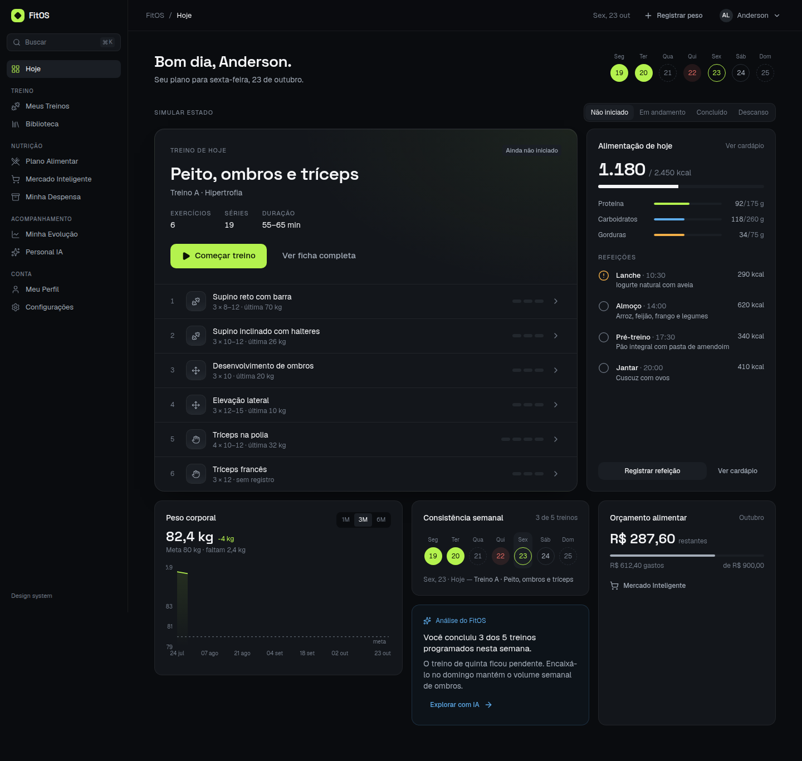
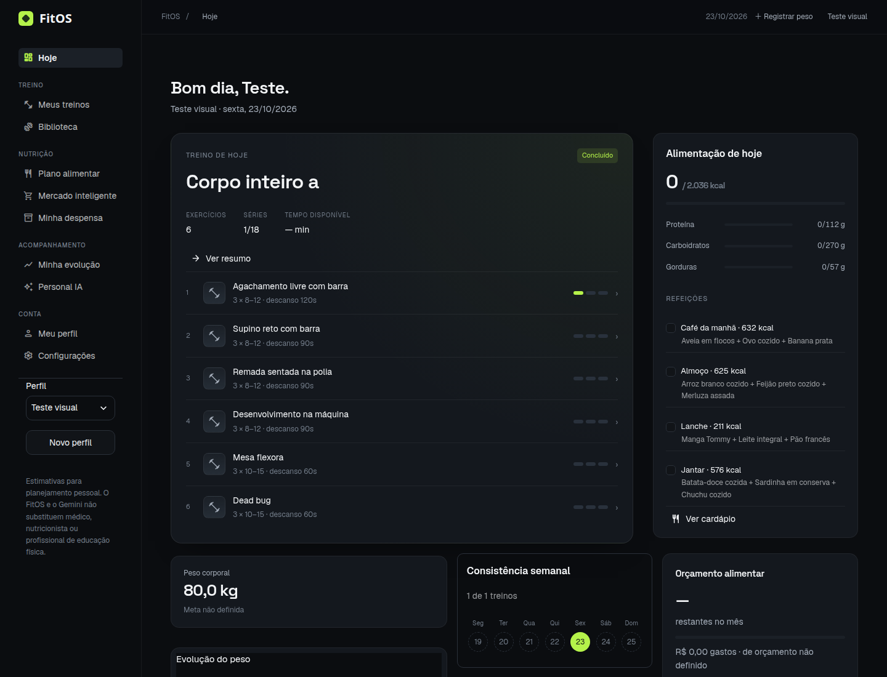
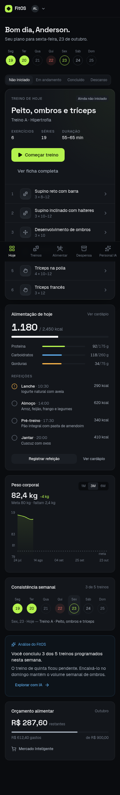
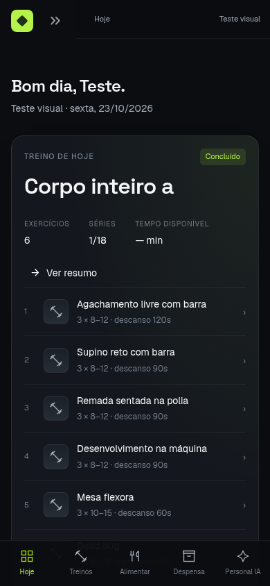

# Reprodução da referência React no Streamlit

Referência: [lime-powered-fit-club](https://github.com/AndersonLems/lime-powered-fit-club/tree/17d1b218e81ed572f8510bd233d1a71fce0c1a50), commit `17d1b218e81ed572f8510bd233d1a71fce0c1a50`.

## Correspondência visual

| React | FitOS |
| --- | --- |
| `styles.css` | `assets/theme.css` e `.streamlit/config.toml`: fundo #0B0D10, superfície #14181E, elevado #1B2027, borda #2A3039, texto #F3F5F7, secundário #A4ADB9, verde #B5F24A; Geist e Space Grotesk |
| `AppShell.tsx` | Sidebar de 230 px, grupos e ícones, barra superior de 56 px, largura máxima de 1180 px, navegação inferior mobile com cinco destinos e menu lateral para todas as páginas |
| `WorkoutPanel.tsx` | Dashboard com hero, estado da sessão, exercícios numerados, séries/repetições/descanso e segmentos de progresso; início e continuação encaminham ao registro real de treino |
| `widgets.tsx` | Calorias, barras de macros, refeições registráveis, peso, consistência semanal e orçamento calculados dos registros |
| `primitives.tsx` | Cartões, etiquetas, listas, cabeçalhos, progressos; linha de 2 px com segmento de 30%, movimento alternado de 2,5 s; shimmer de 1,6 s; entrada de 160 ms, hover de 140/180 ms e progresso de 450 ms |
| Demais rotas | Biblioteca em cartões com detalhe e filtros, painéis de refeições, lista da despensa com editor, formulário de preços recolhível, gráficos, perfil, chat e configurações com os mesmos tokens |

O código React foi lido e executado localmente. As capturas foram feitas com Chrome/Playwright, em 1440 × 1100 e 390 × 844. Os conteúdos são diferentes: React utiliza seus mocks; FitOS utiliza um banco temporário criado pelos testes, com perfil fictício e operações reais dos serviços Python. Nenhum mock foi incorporado ao aplicativo.

## Estados e funcionalidade

- Sem ficha, descanso, treino não iniciado, em andamento e concluído vêm do banco, sem seletor de simulação.
- O dashboard inicia sessões pelo serviço existente. Edição de cargas, repetições, dificuldade, dor e recuperação continua em Meus treinos.
- Refeições registradas no dashboard usam `log_meal`/`unlog_meal`; o total de consumo é recalculado no rerun. Datas fora do plano mostram estado vazio.
- O painel de treino usa o plano da sessão em andamento/finalizada, mesmo se a ficha ativa mudou.
- `ui.loading` envolve operações reais e limpa linha/skeleton em `finally`, inclusive em erro. Spinners nativos também recebem a linha animada. Não há atrasos artificiais.
- `prefers-reduced-motion` desativa animações contínuas. Foco visível, rótulos e estados de progresso permanecem disponíveis.
- Os editores do Streamlit, formulários, seleção de perfil, autenticação, backups e confirmação de ações da IA foram preservados. Nenhum arquivo em `services/`, `database/`, `integrations/`, `migrations/` ou `config/` foi alterado.

## Verificação reproduzível

```sh
python3 -m pytest -q
python3 -m compileall -q app.py components views tests
```

O teste de integração inicia um interpretador separado com SQLite temporário e backup isolado. Abre as dez páginas, gera ficha real, inicia sessão no dashboard, salva séries, finaliza treino, gera cardápio e registra/desmarca refeição, verificando persistência. Os testes anteriores de negócio continuam executando.

Para a revisão de navegador, iniciar Streamlit com `FITOS_DATABASE_URL` apontando **para um banco descartável**, porta 8502, e o React na porta 5173:

```sh
npm install --prefix /tmp/fitos-browser playwright
NODE_PATH=/tmp/fitos-browser/node_modules node scripts/ui_review.cjs
```

O script verifica as dez páginas nas duas larguras, ausência de exceções, ausência de overflow horizontal e navegação mobile; salva imagens e JSON em `/tmp/fitos-review`. URLs, pasta de saída e executável Chrome são configuráveis por variáveis no script.

## Capturas

| Referência React | Streamlit com dados reais de teste |
| --- | --- |
|  |  |
|  |  |

## Limites da comparação

A reprodução utiliza os componentes nativos interativos do Streamlit para preservar todas as operações. Editores tabulares, seletores, formulários e atualização por rerun não têm DOM ou comportamento idênticos aos componentes Radix/React. O histórico adicional do FitOS permanece disponível. Fontes dependem de Google Fonts, com fallback local; mídias dos exercícios continuam nas fontes originais. A miniatura compacta do dashboard usa ícone vetorial como o React, e a biblioteca mantém as demonstrações reais.

Gemini e APIs externas não receberam chamadas nos testes de revisão; os caminhos existentes foram preservados, com estados de indisponibilidade verificados. As capturas documentam aproximação visual, não uma aprovação automática de igualdade pixel a pixel.

Resultado em 23/10/2026: **42 testes pytest passaram**; **20 combinações de página/viewport passaram** no Chrome, sem exceções ou overflow horizontal. Evidência: [browser-results.json](browser-results.json). Os testes de negócio usam seus próprios bancos temporários; a revisão visual também usa banco descartável.
